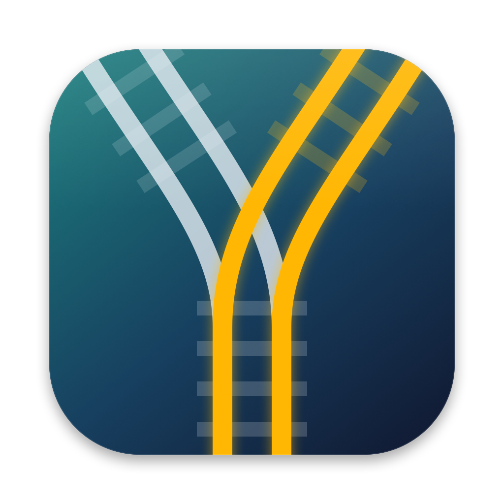
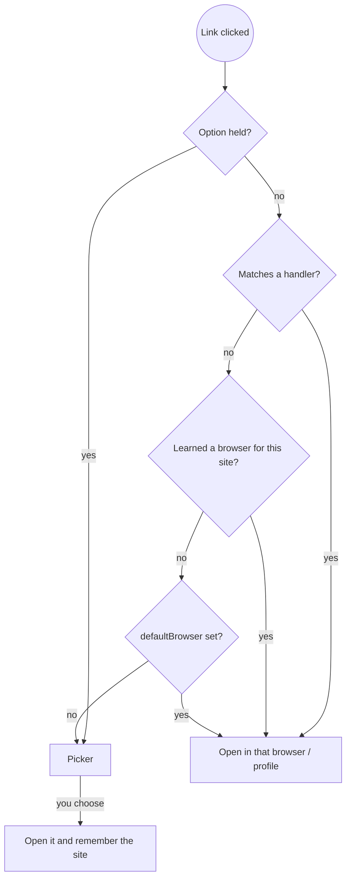

<p align="center">
  
</p>

<h1 align="center">Turnout</h1>

<p align="center">
  A macOS default browser that routes every link to the right browser — by rule, by habit, or by asking.
</p>

---

Turnout sits where your default browser would. When you click a link anywhere on your Mac, it decides which real browser (and which profile) should open it:

- **Rules first.** Ordered regex handlers, first match wins — `github.com/acme-corp` → Firefox *Work* profile, `localhost` → Chrome.
- **Then habit.** It remembers which browser you pick for each site (per registrable domain) and starts opening that site there automatically.
- **Then your default.** Everything else goes to your everyday browser.
- **Or ask.** With no default set — or when you **Option-click** a link — a small Browserosaurus-style picker pops up at the cursor. One keystroke opens the link.

The name comes from railways: a *turnout* is the switch that sends a train onto one track or another.

## How a link is routed



## Features

- **Fast hot path.** The default-browser handler is a tiny native app (Go + Objective-C, no UI). Most links never touch Electron.
- **Finicky-style rules in YAML.** Ordered handlers, regex against the full URL, any-of match lists. No JavaScript is executed.
- **Browser profiles.** `profile: Work` opens Firefox-family browsers (Firefox, Zen, LibreWolf, Floorp — including Firefox 138+'s new profile manager) and Chromium-family browsers (Chrome, Brave, Edge, Vivaldi) in the named profile.
- **Learns per site.** Picks are counted per eTLD+1 (`gist.github.com` and `github.com` share a key); after a threshold, that site auto-opens in your usual browser. Explicit handlers always win over learned habits.
- **Browserosaurus-calibre picker.** Opens instantly at the cursor (pre-warmed, cached icons), keyboard hotkeys, arrow keys, `⌥` to open in the background, `⇧` for a private window, `⌘C` to copy the URL. It's a non-activating panel, so tiling window managers (AeroSpace, Rectangle, …) leave it alone.
- **Explain mode.** `turnout-router -url <url> -explain` prints exactly which rule matched and the `open` command it would run, without opening anything.

## Install

**Beta download:** get the latest DMG from [Releases](https://github.com/thedomguy/turnout/releases), drag **Turnout** to Applications, then, because beta builds aren't notarized yet, run once:

```bash
xattr -dr com.apple.quarantine /Applications/Turnout.app
```

**From source:** macOS 12+, Xcode Command Line Tools, Go 1.22+, Node.js 18+.

```bash
git clone https://github.com/thedomguy/turnout.git
cd turnout
./scripts/release.sh
```

`release.sh` runs the tests, builds the picker, embeds it in `Turnout.app`, signs it, installs it into `/Applications`, seeds `~/.config/turnout/router.yaml` from the example, and launches it. Turnout adds itself as a login item and keeps the picker warm in the background, so the chooser opens instantly.

Then pick **Turnout** in **System Settings → Desktop & Dock → Default web browser**.

To keep that choice across rebuilds, sign with a stable identity — see [Code signing](docs/install.md#code-signing).

## Configure

Policy lives in `~/.config/turnout/router.yaml`:

```yaml
defaultBrowser: Safari

handlers:
  - match: ^https?://(localhost|127\.0\.0\.1)(:\d+)?/
    browser: Google Chrome

  - match:
      - dev\.azure\.com/acme-corp
      - github\.com/acme-corp
    browser: Firefox
    profile: Work

denylist:
  - Figma

frecency:
  minHits: 2
  minScore: 2
```

Changes apply on the next link; nothing needs restarting. Full reference: [docs/config.md](docs/config.md). Coming from Finicky? See [docs/MIGRATE_FINICKY.md](docs/MIGRATE_FINICKY.md).

Check a rule without opening anything:

```bash
cd router && CGO_ENABLED=0 go run ./cmd/turnout-router -url 'https://github.com/acme-corp/app' -explain
```

## How it compares

| | [Finicky](https://github.com/johnste/finicky) | [Browserosaurus](https://github.com/will-stone/browserosaurus) | Turnout |
|---|---|---|---|
| On every click | Rules decide silently | Picker every time | Rules → learned habit → default; picker only when needed or on ⌥-click |
| Rules | JavaScript config | — | YAML, regex, first match wins |
| Learns your habits | — | — | Per-site picks |
| Picker | — | ✓ | ✓ (same keyboard model) |
| Browser profiles | ✓ | — | ✓ (Firefox- and Chromium-family) |
| URL rewriting / short-link expansion | ✓ | — | Not yet |
| Settings UI / auto-update | ✓ | ✓ | Not yet (edit YAML, rebuild) |

If you want a scriptable, battle-tested router, use **Finicky**. If you want a beautiful picker on every link, use **Browserosaurus**. Turnout is for people who want both, plus a router that learns.

## Repository layout

| Path | What |
|---|---|
| `router/` | `Turnout.app` — the default-browser handler (Go + Objective-C, MIT) |
| `picker/` | The chooser (Electron, GPL-3.0), embedded in `Turnout.app` as `Contents/Helpers/Turnout Picker.app` |
| `config/examples/` | Example `router.yaml` and `frecency.json` |
| `assets/icon/` | The app icon, drawn in code (`make-icon.swift` → `build-icon.sh`) |
| `scripts/` | `release.sh` (build + install locally), `beta-release.sh` (package + publish a beta, see [docs/release.md](docs/release.md)), `local-dev.sh` and smoke tests |
| `docs/` | [Install](docs/install.md), [configuration](docs/config.md), [licensing](docs/licensing.md), [migrating from Finicky](docs/MIGRATE_FINICKY.md) |
| `references/` | Finicky and Browserosaurus as git submodules — reading material only, nothing is built from them |

## Development

```bash
cd router && go test ./...          # routing, profiles, frecency
cd picker && npm install && npm test
./scripts/local-dev.sh              # dev Router + picker running from this checkout
./scripts/stop-local-dev.sh
```

Logs: `touch ~/.config/turnout/router.debug`, then `tail -f ~/.config/turnout/router.log`.

## Known limitations

- Learned habits don't decay yet; Option-click to re-pick a site.
- Router and picker can race when both write `frecency.json` at the same instant (rare).
- Double-clicking a local `.html` file isn't handled yet.
- The picker reads its browser order and hotkeys from Browserosaurus's settings if present; it has no settings screen of its own.

## Acknowledgements

Turnout stands on the shoulders of two excellent open-source projects and the people behind them. Thank you.

- **[Finicky](https://github.com/johnste/finicky)** by **John Sterling** ([@johnste](https://github.com/johnste)) — the rules-first model, ordered handlers and first-match-wins semantics, browser-profile handling, and the native Go + Objective-C approach to being a default browser all come from Finicky. Thanks also to its contributors, including **Igor Savelev** and **Stefan Koshy**, and everyone who has filed issues and written configs over its ten years.
- **[Browserosaurus](https://github.com/will-stone/browserosaurus)** by **Will Stone** ([@will-stone](https://github.com/will-stone)) — the picker's look, layout, keyboard model and browser catalogue are derived from Browserosaurus (GPL-3.0), and Turnout reuses your Browserosaurus browser order and hotkeys. Thanks also to its contributors, including **Giacomo Rossetto** and **Florian Weber**.

Built with: [Electron](https://www.electronjs.org/) and [@electron/packager](https://github.com/electron/packager), [file-icon](https://github.com/sindresorhus/file-icon) by Sindre Sorhus, [tldts](https://github.com/remusao/tldts) by Rémi Berson, [js-yaml](https://github.com/nodeca/js-yaml), [Tailwind CSS](https://tailwindcss.com/), Go's [`x/net/publicsuffix`](https://pkg.go.dev/golang.org/x/net/publicsuffix) with Mozilla's [Public Suffix List](https://publicsuffix.org/), and [`yaml.v3`](https://github.com/go-yaml/yaml).

## License

- Router (`router/`, and everything outside `picker/`): **MIT** — see [LICENSE](LICENSE).
- Picker (`picker/`): **GPL-3.0** — see [picker/LICENSE](picker/LICENSE). It is derived from Browserosaurus.

Because the picker ships inside `Turnout.app`, distributing the app carries GPL-3.0 obligations for the picker (source is in this repo); see [docs/licensing.md](docs/licensing.md).
